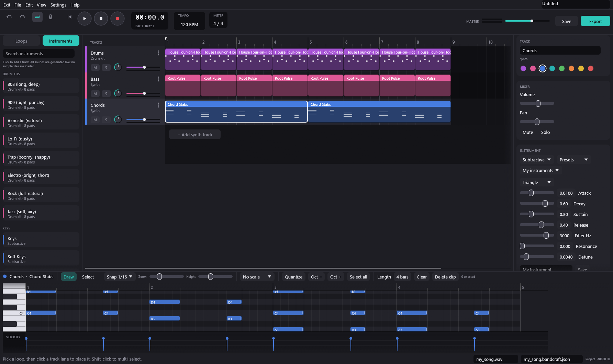

# BandCraft

An easy, BandLab-style music studio written in Rust (egui + cpal). Pick a loop, drop it on a track, tweak the sound, record, and export a WAV.



## Run

```bash
cargo run --release
```

Needs a recent stable Rust toolchain. Audio uses `cpal` (WASAPI on Windows; on Linux it links ALSA).

## Features

- **Arrangement:** multi-track timeline, clip dragging, per-track colors, mute/solo/pan/volume, level meters, loop and metronome. Double-click a lane to add an empty clip; click a loop, then a lane, to place it (with a ghost preview). Delete tracks with the trash icon, right-click menu or Delete key; rename by double-clicking. Ctrl+scroll zooms; the song grows to fit its clips.
- **Selection:** click, shift-click, box-select and drag clips and tracks; Ctrl+A, Ctrl+D, Esc.
- **Piano roll:** variable note lengths, snap (1/4 to 1/32), piano keys, velocity lane, box select, move/resize, quantize, octave shift, copy/paste, scale highlighting, note audition.
- **Instruments (39 premade, all synthesized, no samples needed):** keys, bass, leads, pads, plucked strings, organs, bells and mallets, wavetables; 8 drum kits.
- **Custom instruments:** draw your own wavetable, edit FM / pluck / organ / subtractive parameters, load your own WAV into a sampler or drum pads (only when you press Load), save and reuse instruments, make a sampler from a recording.
- **Recording** from the default input device, WAV import, WAV export (24-bit), project save/load.
- Per-track drive and tempo-synced delay, undo/redo.

## Keys

| Key | Action |
|---|---|
| Space | Play / pause |
| R | Record |
| Ctrl+Z / Ctrl+Y | Undo / redo |
| Ctrl+A / Ctrl+D / Esc | Select all / duplicate / clear selection |
| Delete | Remove selected notes, clips or (after clicking a track name) tracks |
| Double-click lane / header | New empty clip / rename track |
| Q, arrows, Ctrl+C / Ctrl+V | Piano roll: quantize, nudge, copy, paste |

## Layout

| File | Purpose |
|---|---|
| `src/project.rs` | Song model, instruments, presets, loop library |
| `src/dsp.rs` | Voices (drums, subtractive, wavetable, FM, pluck, organ, sampler) |
| `src/engine.rs` | Renderer for realtime playback and export |
| `src/audio.rs` | Audio I/O, WAV import/export, recording |
| `src/ui.rs`, `src/panels.rs`, `src/roll.rs`, `src/theme.rs` | Interface |

## Tests

```bash
cargo test
```

## License

[The Unlicense](LICENSE): public domain.
